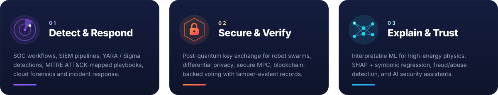

  

 

 

## ⚡ TL;DR

Cybersecurity grad researcher at **Arizona State University**. I work where security operations meets AI — building detection pipelines, forensics tooling, and cryptographic systems, then making sure a human can actually understand what they decided and why.

Published at **Stanford PAI26 / NeurIPS 2026**, **Springer**, and **DRDO**. One patent filing. A habit of shipping things that look like products, not homework.

 

## 🚀 Featured work

<table>
<tr>
<td width="50%" valign="top">

### 🛡️ Security Incident Response Framework

End-to-end SOC pipeline: synthetic telemetry → rule-based detection → AI-assisted triage → IOC extraction → severity scoring → playbooks. Six **MITRE ATT&CK**-mapped scenarios (phishing, ransomware, insider, lateral movement, cloud misconfig, DDoS). Containment ships with a dry-run path.

**[→ Explore the framework](https://github.com/mansi200304/security-incident-response-plan)**

</td>
<td width="50%" valign="top">

### 🌐 Jarvis Cyber Command Center

An immersive cyber-physical security simulator: holographic threat globe, live attack routes, radar-wave particles, scrolling telemetry console, and a spoken AI narrator. Security events you can walk around in.

**[→ Source](https://github.com/mansi200304/VR-Security-Training) · [→ Live lab](https://mansi200304.github.io/XR-and-Cybersecurity-Portfolio/)**

</td>
</tr>
<tr>
<td width="50%" valign="top">

### ☁️ Cloud Forensics Pipeline

Serverless IR for EC2: a GuardDuty finding triggers preserve → EBS snapshot → live memory capture (AVML over SSM) → isolate, in order of volatility. Every step lands in a **hash-chained chain-of-custody ledger** with an independent verifier. First evidence preserved in under 10 s; IOCs recovered from memory after the attacker wiped bash history.

**[→ Repository](https://github.com/mansi200304/cloud-forensics-pipeline)**

</td>
<td width="50%" valign="top">

### 🔍 AWS Fraud & Abuse Analyzer

ML detection for account takeover, cryptomining abuse, privilege escalation, exfiltration, and anomalous API activity — with SHAP attributions so every flag comes with a reason.

</td>
</tr>
<tr>
<td width="50%" valign="top">

### 🗳️ SafeCount — Secure E-Voting

Two-step verified voting with identity checks, role separation, and tamper-evident on-chain records. **Patent filed, India 2024.**

</td>
<td width="50%" valign="top">

### 🤖 CyberGuard AI Assistant

Adaptive security-training assistant: generates threat scenarios, extracts IOCs from free text, and scores analyst responses. In active development.

</td>
</tr>
</table>

 

## 📄 Research

| Work | Venue | What it does | |
|:--|:--|:--|:--|
| **JetMAE** — Interpretable neural jet tagging | Stanford PAI26 · NeurIPS 2026 | Masked autoencoder on 1M LHC jets + SHAP + symbolic regression to expose *why* the tagger decides | [PDF](https://openreview.net/attachment?id=nlt2r1P7yU&name=pdf) |
| **Post-quantum crypto for P2P robot comms** | DRDO CAIR · 2024 | Multi-layer PQ-KEM + AES-256 + ECC framework across five robotic platforms | [Paper](https://drive.google.com/file/d/1y1S-4z8VWZj9rMacXHrjvW3rh4hd9Lzg/view) |
| **Situational awareness for autonomous vehicles** | Springer · 2026 | Multimodal sensor fusion + threat scoring under adverse conditions | [Chapter](https://link.springer.com/chapter/10.1007/978-3-032-14156-9_35) |
| **Future trends: cybersecurity & blockchain** | Springer · 2026 | AI-enabled threats, PQ transition, zero-trust, smart-contract security | [Chapter](https://link.springer.com/chapter/10.1007/978-3-032-14156-9_37) |
| **Privacy-preserving data verification** | IJARESM · 2024 | Differential privacy + secure MPC; accuracy/privacy trade-offs | [Paper](https://ijaresm.com/uploaded_files/document_file/Mohammed_Emad_Sultan_SiddiqipInA.pdf) |
| **SafeCount** — Two-step verified secure voting | Patent filing · India 2024 | Identity + role separation + tamper-evident records | — |

 

## 🧰 Toolkit

**Security ops & forensics** 

**Cryptography & distributed systems** 

**AI & data** 

**Cloud & build** 

 

## 📈 Activity

 

## 🎓 Certifications

`Google Network Security` · `Google Manage Security Risks` · `Palo Alto Cybersecurity Fundamentals` · `AWS Cloud Foundations` · `IBM Generative AI & Prompt Engineering` · `Anthropic AI Fluency` · `Claude 101` · `Vanderbilt Prompt Engineering` · `UMD Cybersecurity for Everyone`

 

  

Tempe, Arizona · Detect · Defend · Explain

