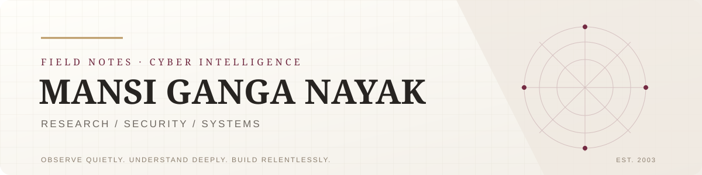
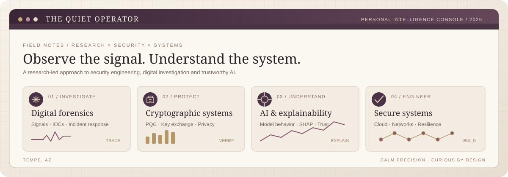
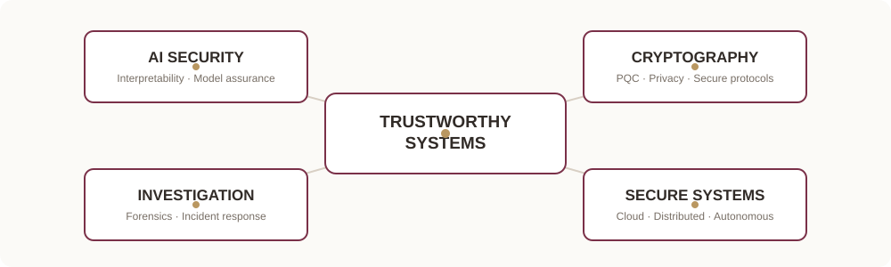
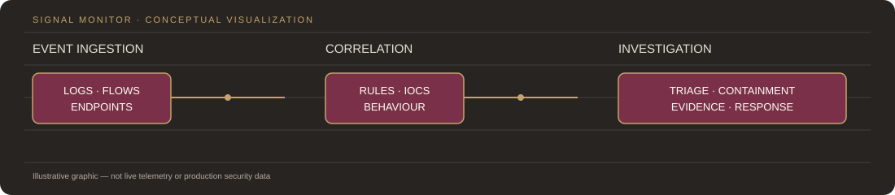

 

**Observe quietly. Understand deeply. Build relentlessly.**

[Portfolio](https://mansi200304.github.io/Cybersecurity-Portfolio---Mansi-Ganga-Nayak) · [XR & Cybersecurity Lab](https://mansi200304.github.io/XR-and-Cybersecurity-Portfolio/) · [LinkedIn](https://linkedin.com/in/mansiganganayak) · [Email](mailto:mnayak12@asu.edu)

[⌁ Research](#02--research-desk) · [◉ Projects](#03--selected-builds) · [⌘ Systems](#05--systems--signals) · [↗ Contact](mailto:mnayak12@asu.edu)

---

## 01 / The operator

I’m a cybersecurity graduate researcher at **Arizona State University**, working across security engineering, AI security, cryptography, and applied research.

My work moves between two questions:

- How do we make complex systems more secure?
- How do we make their decisions more understandable, verifiable, and trustworthy?

I’ve explored post-quantum cryptography for autonomous robotic platforms, privacy-preserving data verification, interpretable machine learning, blockchain systems, and immersive cybersecurity environments.

I’m particularly interested in the intersection of **digital forensics, incident response, threat intelligence, AI security, and cryptographic engineering**.

TEMPE, ARIZONA · RESEARCH / SECURITY ENGINEERING / SYSTEMS

---

## 02 / Research desk

Five peer-reviewed publications · One patent filing · Research spanning Stanford PAI26, Springer, DRDO and IJARESM.

### JetMAE — Interpretable Neural Tagging
**PAI26, Stanford University / NeurIPS 2026**

A masked-autoencoder approach to quark/gluon classification using 1 million LHC jets. The work combines masked reconstruction, SHAP attribution, and symbolic regression to examine how a neural tagger makes decisions.

[Read the paper](https://openreview.net/attachment?id=nlt2r1P7yU&name=pdf)

### Quantum Cryptographic Encryption for P2P Robot Communication
**DRDO Centre for AI and Robotics · 2024**

A multi-layer cryptographic framework for peer-to-peer communication across five robotic platforms. Explores post-quantum key encapsulation, AES-256, RSA-4096, ECC, integrity hashing, and key exchange.

[Read the research](https://drive.google.com/file/d/1y1S-4z8VWZj9rMacXHrjvW3rh4hd9Lzg/view)

### Privacy-Preserving Data Verification
**IJARESM · September 2024**

An investigation of differential privacy and secure multi-party computation for data verification workflows, with attention to accuracy–privacy trade-offs.

[Read the paper](https://ijaresm.com/uploaded_files/document_file/Mohammed_Emad_Sultan_SiddiqipInA.pdf)

### Situational Awareness for Autonomous Vehicles
**Springer · February 2026**

Research into multimodal perception, sensor fusion, and threat scoring for autonomous vehicles operating under adverse conditions.

[Read the chapter](https://link.springer.com/chapter/10.1007/978-3-032-14156-9_35)

### Future Trends in Cybersecurity and Blockchain
**Springer · February 2026**

An analysis of AI-enabled threats, post-quantum transition, zero-trust architecture, smart-contract security, and tamper-evident audit trails.

[Read the chapter](https://link.springer.com/chapter/10.1007/978-3-032-14156-9_37)

**Patent filing** · *SafeCount — Two-Step Verification Based Secure Voting System* · India, 2024.

---

## 03 / Selected builds

<table>
<tr>
<td width="50%" valign="top">

### ◈ Jarvis Cyber Command Center
`Three.js` · `WebXR` · `GLSL` · `Web Audio`

An immersive cyber-physical security simulator built around a holographic threat globe. Rotating HUD rings, radar-wave particles, simulated attack routes, a scrolling telemetry console, and a spoken AI-style narrator turn security events into an explorable environment.

**Explore:** [Source repository](https://github.com/mansi200304/VR-Security-Training) · [XR & Cybersecurity Lab](https://mansi200304.github.io/XR-and-Cybersecurity-Portfolio/)

</td>
<td width="50%" valign="top">

### ◈ Security Incident Response Framework
`Python` · `YARA-L` · `Sigma` · `Splunk`

An end-to-end SOC workflow connecting synthetic event generation, rule-based detection, AI-assisted alert triage, IOC extraction, severity scoring, and response playbooks. Six MITRE ATT&CK-mapped scenarios cover phishing, ransomware, insider threats, lateral movement, cloud misconfiguration, and DDoS. Containment is designed with a dry-run path; performance figures are simulation results.\n\n[Explore the framework](https://github.com/mansi200304/security-incident-response-plan)

</td>
</tr>
<tr>
<td width="50%" valign="top">

### ◈ Cloud-Based SIEM
`AWS` · `Splunk` · `Python` · `Lambda`

A cloud-hosted monitoring pipeline for aggregating endpoint, network, and cloud events, with custom detection rules, alerting, and automated log ingestion.

</td>
<td width="50%" valign="top">

### ◈ SafeCount — Secure EVM Voting
`Blockchain` · `Solidity` · `Cryptography`

A multi-factor electronic voting system concept combining identity verification, role separation, blockchain-backed validation, and tamper-evident records. Associated with the SafeCount patent filing.

</td>
</tr>
<tr>
<td width="50%" valign="top">

### ◈ AWS Fraud Detection & Abuse Analyzer
`Python` · `AWS` · `XGBoost` · `SHAP`

An ML-based cloud analytics concept for examining account takeover, cryptomining abuse, privilege escalation, data exfiltration, and suspicious API activity.

</td>
<td width="50%" valign="top">

### ◈ CyberGuard AI Security Assistant
`Python` · `NLP` · `spaCy` · `REST API`

An AI-assisted security learning platform in development, focused on adaptive threat scenarios and indicator-of-compromise extraction.

</td>
</tr>
</table>

### ◈ Cloud-Based Language Translator
`Machine Learning` · `NLP` · `AWS`

A cloud-deployed language translation project using neural machine-translation techniques and NLP. The focus is on making translation accessible through a scalable hosted service rather than limiting it to a local experiment.

**Explore:** [Source repository](https://github.com/mansi200304/Cloud-Based-Language-Translator)

## 04 / How I approach a system

I like projects where the technical pieces form a complete, inspectable workflow—not just a model or interface in isolation.

1. **Observe the system.** Identify assets, data flows, trust boundaries, and the signals that matter.
2. **Model the risk.** Translate vague concerns into concrete threats, attack paths, failure modes, and measurable requirements.
3. **Build the mechanism.** Implement detection, cryptographic controls, data processing, or interactive simulation with clear interfaces.
4. **Validate the result.** Use test cases, controlled simulations, explainability, and measurable checks to understand what works and where it fails.
5. **Make it legible.** Document the architecture and surface useful evidence so another engineer or analyst can reproduce the reasoning.

That approach connects my work in digital investigation, AI security, cryptography, cloud systems, and immersive training.

---

## 05 / Systems & signals

**Security & investigation**  
Incident response · Digital forensics · Threat intelligence · SIEM · Vulnerability assessment · Network security · Detection engineering · MITRE ATT&CK · YARA · Sigma

**Cryptography & distributed systems**  
Post-quantum cryptography · AES · RSA · ECC · Diffie–Hellman · Differential privacy · Secure multi-party computation · Blockchain · Smart contracts

**AI & data science**  
Python · PyTorch · scikit-learn · XGBoost · SHAP · NLP · Anomaly detection · Explainable AI · Data analysis

**Cloud & infrastructure**  
AWS · EC2 · S3 · IAM · Lambda · CloudWatch · Docker · Linux · Bash

**Development & immersive systems**  
JavaScript · SQL · Solidity · Three.js · WebXR · GLSL · Streamlit

---

## 06 / Certifications

Anthropic AI Fluency Framework · Claude 101 · Palo Alto Cybersecurity Fundamentals · Google Network Security · Google Manage Security Risks · University of Maryland Cybersecurity for Everyone · IBM Generative AI & Prompt Engineering · Vanderbilt Prompt Engineering · AWS Cloud Foundations

---

## 07 / Current trajectory

I’m interested in opportunities and collaborations across:

- Security engineering and security operations
- Incident response and digital forensics
- Threat intelligence and detection engineering
- AI and machine-learning security
- Cryptography and secure distributed systems
- Cloud security and fraud analytics

I value work that combines technical depth with practical impact—and teams that take rigorous investigation as seriously as implementation.

---

**MANSI GANGA NAYAK**

RESEARCH WITH INTENT · ENGINEERING WITH PRECISION

[Portfolio](https://mansi200304.github.io/Cybersecurity-Portfolio---Mansi-Ganga-Nayak) · [LinkedIn](https://linkedin.com/in/mansiganganayak) · [Email](mailto:mnayak12@asu.edu)

