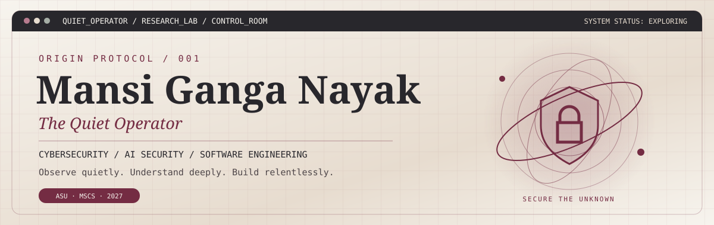
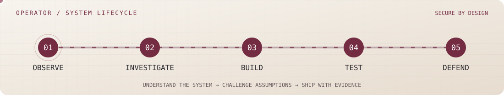
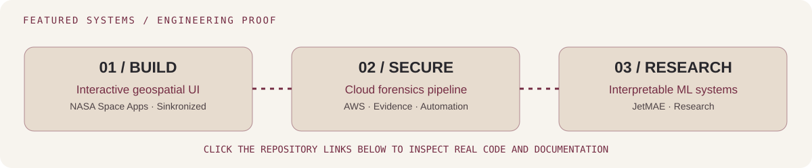
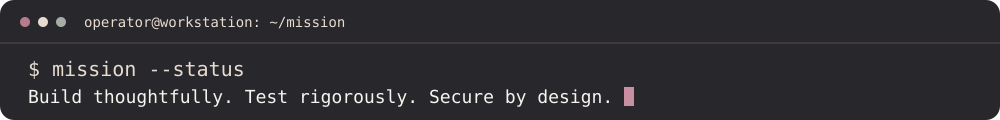

### Mansi Ganga Nayak
**Software Engineering · Cybersecurity · Digital Forensics · Security Research**

*The investigator who builds.*

`Arizona State University · MS Computer Science (Cybersecurity) · December 2027`

[My story](#-the-investigator-who-builds) · [Engineering](#-systems-ive-built) · [Research](#-research--publications) · [Hackathons](#-building-with-others) · [Toolkit](#-technical-toolkit) · [Connect](#-connect)

---

## ✦ The investigator who builds

> “In earlier days, the front door of our house was our security. Today, our security lies beneath our fingertips — in the code we write, the systems we design, and the vigilance we maintain.”

I didn't begin in cybersecurity. I began with a question: **what happens when a system we trust stops protecting us?**

A roommate introduced me to ethical hacking, and I switched lanes from finance to security. I was fascinated by how systems worked, where assumptions broke down, and what careful investigation could reveal.

Then the questions became personal. My social media account was compromised, and I never recovered the data. Later, more than $1,000 disappeared after my card was skimmed at a restaurant. I investigated the suspicious transactions, traced a common network indicator, secured my accounts, and recovered the money.

Those experiences changed how I approach technology. **I don't want to stop at identifying a vulnerability. I want to understand the system, build a better one, and test whether the fix actually holds.**

Today, I'm pursuing an **MS in Computer Science with a cybersecurity specialization at Arizona State University**, graduating in **December 2027**. I began working on research with a professor in **October 2026**. My work connects software engineering, cloud security, digital forensics, explainable AI, and applied research.

**My principle:** Build thoughtfully. Test rigorously. Secure by design.

---

## ◈ Two disciplines. One engineering mindset.

<table>
<tr><td width="50%" valign="top">

### 💻 Build systems

I turn ambiguous problems into working software: interactive applications, data pipelines, machine-learning experiments, and tools that make complex information usable.

I care about clear architecture, readable code, deliberate tradeoffs, and the difference between a demonstration and a reliable system.

**Explore:** [NASA Space Apps](https://github.com/mansi200304/NASA-Hackathon) · [JetMAE](https://github.com/mansi200304/JetMAE-Jet-Masked-Autoencoder) · [Live workstation](https://mansi200304.github.io/mansi-s_portfolio/)

</td><td width="50%" valign="top">

### 🛡️ Investigate and defend

I study how systems fail, how attackers exploit assumptions, and how defenders can preserve evidence and respond with confidence.

That means connecting cloud automation, access controls, incident-response workflows, cryptography, and security research to practical engineering decisions.

**Explore:** [Cloud Forensics Pipeline](https://github.com/mansi200304/cloud-forensics-pipeline) · [Incident Response Framework](https://github.com/mansi200304/security-incident-response-plan)

</td></tr>
</table>

**Currently seeking Summer 2027 internships in Software Development Engineering and Security Engineering.** My long-term focus is on building trustworthy software and investigating real-world threats.

---

## ⚙️ Systems I've built

*Not just a list of technologies. Each project starts with a problem, an engineering approach, and something you can inspect.*

### 🛰️ Sinkronized — NASA Space Apps 2026

**Problem:** Earth-observation data can be difficult to interpret, especially when measurements, visualizations, and uncertainty are separated.

**Approach:** An interactive geospatial experience exploring InSAR-derived land movement and subsidence, with attention to data interpretation and scientific limitations.

**Evidence:** [Repository and methodology](https://github.com/mansi200304/NASA-Hackathon) · [Live application](https://sinkronized.vercel.app/web/)

### ☁️ Cloud Forensics Pipeline

**Problem:** Cloud incidents demand timely evidence collection without sacrificing scope control or integrity.

**Approach:** An event-driven AWS investigation workflow using Lambda and EventBridge, scoped evidence handling, and hash-chain verification.

**Evidence:** [Architecture, implementation and incident walkthrough](https://github.com/mansi200304/cloud-forensics-pipeline)

### 🧠 JetMAE — Jet Masked Autoencoder

**Problem:** Machine-learning models are useful only when we can meaningfully evaluate what they learn and where their interpretations are limited.

**Approach:** Research-oriented model experimentation and interpretability, with attention to reproducibility and the boundary between results and claims.

**Evidence:** [Implementation](https://github.com/mansi200304/JetMAE-Jet-Masked-Autoencoder) · [Research paper](https://openreview.net/attachment?id=nlt2r1P7yU&name=pdf)

### 🔎 Security Incident Response Framework

**Problem:** An incident-response plan should help an investigator decide what to examine, preserve, and do next.

**Approach:** Structured detection, triage, and response workflows aligned with MITRE ATT&CK concepts.

**Evidence:** [Framework repository](https://github.com/mansi200304/security-incident-response-plan)

### 🥽 VR Security Training

**Problem:** Security concepts are easier to understand when learners can experience decisions and consequences.

**Approach:** Explore immersive simulation as a way to teach security behavior and threat awareness.

**Evidence:** [Project repository](https://github.com/mansi200304/VR-Security-Training)

### 🔐 Ethereum Course Registration

**Problem:** What changes when application rules are expressed through smart contracts?

**Approach:** Explore decentralized course-registration logic and its engineering tradeoffs.

**Evidence:** [Coursework repository](https://github.com/mansi200304/Course_Registration_Ethereum)

---

## 🧪 Enter the workstation

I prefer work you can examine over claims you have to take on trust. My [interactive portfolio](https://mansi200304.github.io/mansi-s_portfolio/) brings together tools, investigations, and project demos.

| Experience | What you can explore |
|:--|:--|
| **TriageLens** | Browser-based file triage using hashes, signatures, and entropy |
| **IAMSentry** | Static inspection of AWS IAM policies for risky permissions |
| **Cloud Fraud & Abuse Analyzer** | Anomaly detection, machine learning, and explainability experiments |
| **BankSim Fraud-Detection Ensemble** | Comparative approaches to suspicious-transaction detection |
| **Interactive investigations** | Follow evidence and make decisions through guided security cases |

**[Open the interactive workstation](https://mansi200304.github.io/mansi-s_portfolio/)**

---

## 📚 Research & publications

*Research taught me to be as interested in a model's limitations as in its strongest result.*

My research interests span explainable AI, cybersecurity, privacy-preserving systems, autonomous-system safety, cryptography, and the governance of emerging technologies.

| Work | Research direction | Read |
|:--|:--|:--|
| **Hippo — Explainable, Security-by-Design Health Insurance Platform** | Explainable decisions, protected data and secure architecture | [Portfolio](https://mansi200304.github.io/mansi-s_portfolio/) |
| **Autonomous Cyber Weapons as AI-Enabled Digital Harms** | AI-enabled threats and governance | [CMU IDeaS 2026](https://www.cmu.edu/ideas-social-cybersecurity/events/ideas-conferences/2026_ideas_conference_paper__18.pdf) |
| **Democratic Accountability for Autonomous Systems** | Accountability and autonomous technology | [CMU IDeaS 2026](https://www.cmu.edu/ideas-social-cybersecurity/events/ideas-conferences/2026_ideas_conference_paper__17.pdf) |
| **JetMAE** | Representation learning and model interpretation | [Paper](https://openreview.net/attachment?id=nlt2r1P7yU&name=pdf) |
| **Improving Situational Awareness of Autonomous Vehicles** | Autonomous-system safety | [Springer](https://link.springer.com/chapter/10.1007/978-3-032-14156-9_35) |
| **Future Trends in Cybersecurity and Blockchain** | Distributed systems and security | [Springer](https://link.springer.com/chapter/10.1007/978-3-032-14156-9_37) |
| **Quantum Cryptographic Encryption for P2P Robot Communication** | Cryptography and robotics | DRDO-related work, 2024 |
| **Enhancing Data Verification Through Privacy-Preserving Techniques** | Privacy-preserving verification | [Paper](https://ijaresm.com/uploaded_files/document_file/Mohammed_Emad_Sultan_SiddiqipInA.pdf) |

Additional explorations include real-estate price prediction, front-running research, and the SafeCount secure-voting concept. Project maturity and research status vary; see the linked materials for context.

---

## 🚀 Building with others

Hackathons are where I practice turning uncertainty, time pressure, and competing ideas into a working prototype.

| Event | Project | Challenge |
|:--|:--|:--|
| **NASA Space Apps 2026** | [Sinkronized](https://github.com/mansi200304/NASA-Hackathon) | Make Earth-observation and land-movement data explorable |
| **Cubbie Hackathon · DevHacks ASU** | [Orbit](https://github.com/Manavpatel06/Orbit) | Privacy-conscious agent coordination · [Demo](https://orbit-cubbie.vercel.app) |
| **Devils Invent 2026 · Honeywell Aerospace × ASU** | [ARC](https://github.com/Manavpatel06/FLOCK) | Security and radio-layer engineering |
| **AIR Spark Hackathon · ASU** | [Rice Matters](https://github.com/QuaanNguyen/border-collie) | Reliability and monitoring of AI coding agents |

---

## 🧰 Technical toolkit

**Programming & software:** Python · Java · C/C++ · JavaScript · SQL · Data structures and algorithms · Object-oriented programming

**Security & investigation:** Incident response · Digital forensics · Threat analysis · MITRE ATT&CK · IAM · Splunk · Sigma · YARA-L

**Cloud & systems:** AWS · Lambda · EventBridge · Docker · Linux · Cloud automation

**AI & data:** PyTorch · scikit-learn · XGBoost · SHAP · Model evaluation · Explainability

**Learning:** AWS Academy Cloud Foundations · Anthropic AI Fluency: Framework & Foundations · Palo Alto Networks Cybersecurity Fundamentals · Google Networks & Network Security · Google Manage Security Risks · Cybersecurity for Everyone (University of Maryland)

---

## 📊 Engineering activity

Third-party activity widgets may occasionally be unavailable.

---

## 🌷 Beyond the terminal

Racing and fast cars, archery, horse riding, LEGO builds, painting, sketching, dancing, and playing the ukulele, keyboard, and electric drums. I also organize events and develop investment strategies.

I am curious by nature, drawn to complex problems, and always looking for another perspective. The same curiosity that makes me take something apart to understand it is what brings me back to the terminal to build it better.

---

## 💌 Connect

**Build thoughtfully. Test rigorously. Secure by design.**

[Portfolio](https://mansi200304.github.io/mansi-s_portfolio/) · [Projects](https://github.com/mansi200304?tab=repositories) · [LinkedIn](https://linkedin.com/in/mansiganganayak) · [Email](mailto:mnayak12@asu.edu)

