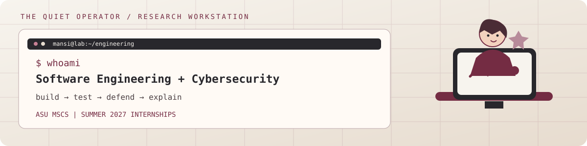
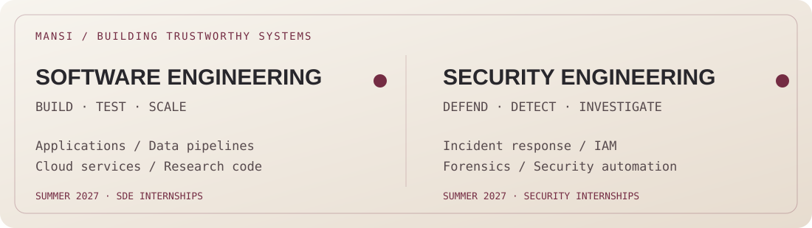

### Mansi Ganga Nayak
**MSCS Candidate · Software Development & Security Engineering · AI Research**

*Observe quietly. Understand deeply. Build relentlessly.*

`ASU · MSCS Cybersecurity · December 2027` &nbsp; `Tempe, Arizona`

[About](#-about-me) · [Projects](#-featured-engineering-projects) · [Research](#-research--publications) · [Hackathons](#-hackathons--team-projects) · [Skills](#-technical-toolkit) · [Contact](#-connect)

---

## ✨ About me

I'm a **Master's student in Computer Science (Cybersecurity) at Arizona State University**, with an expected graduation date of **December 2027**. I began working on research with a professor in **October 2026**.

I design and build software with security at its foundation. My work spans **software engineering, cloud infrastructure, cybersecurity, digital forensics, AI security, and explainable machine learning**. I care about the details: what happens when a system fails, how evidence is preserved, and how we can make intelligent technology more trustworthy.

Outside conventional security workflows, I explore **immersive training, Earth-observation data, and human-centered interfaces**. My approach combines the rigor of a researcher with the curiosity of a builder.

> **My story:** Understand the system → challenge its assumptions → build a safer version → document what the evidence actually shows.

### 🎯 I build software. I secure systems.

**One engineering foundation. Two kinds of problems I love solving.** I'm targeting **Summer 2027 Software Development Engineer (SDE) and Security Engineering internships**.

<!-- VISUAL 01: a bespoke dual-track illustration -->

<!-- VISUAL 02: paired feature panels -->
<table>
<tr>
<td width="50%" valign="top">

#### 💻 Build / Software Engineering

I enjoy turning complex requirements and messy data into understandable, usable software.

**What I bring:** Python, Java, C/C++, JavaScript, problem solving, data processing, interactive web interfaces, and cloud-based automation.

**Explore the work:** [Sinkronized](https://github.com/mansi200304/NASA-Hackathon) · [JetMAE](https://github.com/mansi200304/JetMAE-Jet-Masked-Autoencoder) · [Interactive Workstation](https://mansi200304.github.io/mansi-s_portfolio/)

</td>
<td width="50%" valign="top">

#### 🛡️ Protect / Security Engineering

I investigate failure modes, automate defensive workflows, and care about evidence and trustworthy design.

**What I bring:** AWS, IAM, forensics, incident response, threat analysis, cryptography, and security-focused research.

**Explore the work:** [Cloud Forensics](https://github.com/mansi200304/cloud-forensics-pipeline) · [Incident Response](https://github.com/mansi200304/security-incident-response-plan) · [TriageLens & IAMSentry](https://mansi200304.github.io/mansi-s_portfolio/)

</td>
</tr>
</table>

<!-- VISUAL 03: evidence-first project spotlights -->
#### ✦ Selected engineering evidence

| 🔬 Real project | 💡 What it demonstrates | 🔗 See it |
|:--|:--|:--|
| **Sinkronized / NASA Space Apps** | Interactive geospatial product, multi-source radar-data processing, documented uncertainty and reproducibility | [Code & methodology](https://github.com/mansi200304/NASA-Hackathon) · [Live demo](https://sinkronized.vercel.app/web/) |
| **Cloud Forensics Pipeline** | AWS Lambda / EventBridge orchestration, safe scope guards, independent hash-chain verification and a documented attack-to-investigation test | [Architecture & incident report](https://github.com/mansi200304/cloud-forensics-pipeline) |
| **JetMAE** | Research-oriented machine learning implementation and model interpretation | [Repository](https://github.com/mansi200304/JetMAE-Jet-Masked-Autoencoder) |

**Next engineering focus:** backend services, API design, automated tests, CI workflows, and secure deployments. My projects demonstrate implementation and research; I am continuing to build production-style backend experience.

### 🔭 Currently exploring

- **AI security and trustworthy systems** — research and interpretable models
- **Cloud security and digital forensics** — evidence, automation, and incident response
- **Software engineering** — robust implementation, testing, and maintainable architectures
- **Summer 2027 internships** — SDE, security engineering, and related software-security roles

---

## 🛡️ Featured engineering projects

*The laboratory is organized by problems, not fictional job titles. Every card leads to real work.*

| Project | Engineering focus | Explore |
|:--|:--|:--|
| ☁️ **Cloud Forensics Pipeline** | Event-driven AWS incident response, evidence capture, chain of custody | [Repository](https://github.com/mansi200304/cloud-forensics-pipeline) |
| 🔎 **Security Incident Response Framework** | MITRE ATT&CK-mapped playbooks, detection, triage | [Repository](https://github.com/mansi200304/security-incident-response-plan) |
| 🧠 **JetMAE — Jet Masked Autoencoder** | Machine-learning research and model interpretability | [Repository](https://github.com/mansi200304/JetMAE-Jet-Masked-Autoencoder) |
| 🥽 **VR Security Training** | Immersive cybersecurity education and simulation | [Repository](https://github.com/mansi200304/VR-Security-Training) |
| 🛰️ **NASA Space Apps — Sinkronized** | Earth observation, InSAR and subsidence visualization | [Repository](https://github.com/mansi200304/NASA-Hackathon) · [Live](https://sinkronized.vercel.app/web/) |
| 🔐 **Ethereum Course Registration** | Smart-contract coursework and decentralized application exploration | [Repository](https://github.com/mansi200304/Course_Registration_Ethereum) |

### 🧪 Live security experiments

<table><tr><td width="50%" valign="top">

**🧬 TriageLens — File Forensics**  
Browser-based file analysis using hashes, file signatures, and entropy. Designed around local processing.

</td><td width="50%" valign="top">

**🔑 IAMSentry — IAM Policy Auditor**  
Static AWS IAM policy inspection to surface privilege and configuration risks.

</td></tr><tr><td width="50%" valign="top">

**📈 Cloud Fraud & Abuse Analyzer**  
Experiments in anomaly detection, supervised learning, and explainability for cloud abuse patterns.

</td><td width="50%" valign="top">

**💳 BankSim Fraud-Detection Ensemble**  
Comparative fraud-detection approaches, including models that do not depend on fraud labels.

</td></tr></table>

**[Open the interactive workstation and project demos →](https://mansi200304.github.io/mansi-s_portfolio/)**

---

## 📚 Research & publications

*Research is where I test ideas, document limitations, and learn to distinguish a promising result from a proven one.*

| Research | Topic | Source |
|:--|:--|:--|
| **Hippo — Explainable, Security-by-Design Health Insurance Platform** | Security architecture, explainable decisions, protected data | [Portfolio overview](https://mansi200304.github.io/mansi-s_portfolio/) |
| **Autonomous Cyber Weapons as AI-Enabled Digital Harms** | AI-enabled cyber harms and governance | [CMU IDeaS 2026](https://www.cmu.edu/ideas-social-cybersecurity/events/ideas-conferences/2026_ideas_conference_paper__18.pdf) |
| **Democratic Accountability for Autonomous Systems** | Governance and accountability | [CMU IDeaS 2026](https://www.cmu.edu/ideas-social-cybersecurity/events/ideas-conferences/2026_ideas_conference_paper__17.pdf) |
| **JetMAE** | Neural model interpretation | [Research PDF](https://openreview.net/attachment?id=nlt2r1P7yU&name=pdf) |
| **Improving Situational Awareness of Autonomous Vehicles** | Autonomous-system safety | [Springer](https://link.springer.com/chapter/10.1007/978-3-032-14156-9_35) |
| **Future Trends in Cybersecurity and Blockchain** | Security and distributed systems | [Springer](https://link.springer.com/chapter/10.1007/978-3-032-14156-9_37) |
| **Quantum Cryptographic Encryption for P2P Robot Communication** | Cryptography and robotics | DRDO-related work, 2024 |
| **Enhancing Data Verification Through Privacy-Preserving Techniques** | Privacy-preserving verification | [Paper](https://ijaresm.com/uploaded_files/document_file/Mohammed_Emad_Sultan_SiddiqipInA.pdf) |

**Additional research and IP:** Real Estate Price Predictor & Minor Extractable Values (Front-Running); *SafeCount* two-step verification secure voting concept. Details and statuses are documented in the broader [portfolio](https://mansi200304.github.io/mansi-s_portfolio/).

---

## 🚀 Hackathons & team projects

| Event | Project | Contribution / theme |
|:--|:--|:--|
| **NASA Space Apps 2026** | [Sinkronized](https://github.com/mansi200304/NASA-Hackathon) | InSAR / Earth observation, land-subsidence visualization · [Demo](https://sinkronized.vercel.app/web/) |
| **Cubbie Hackathon · DevHacks ASU** | [Orbit](https://github.com/Manavpatel06/Orbit) | Privacy-conscious agent coordination · [Demo](https://orbit-cubbie.vercel.app) |
| **Devils Invent 2026 · Honeywell Aerospace × ASU** | [ARC](https://github.com/Manavpatel06/FLOCK) | Security and radio-layer engineering |
| **AIR Spark Hackathon · ASU** | [Rice Matters](https://github.com/QuaanNguyen/border-collie) | Monitoring and reliability of AI coding agents |

---

## ⚙️ Technical toolkit

**Security & investigation**  
     

**Languages & software engineering**  
    

**Cloud, data & research**  
      

---

## 🏅 Learning & certifications

AWS Academy Cloud Foundations · AI Fluency: Framework & Foundations (Anthropic) · Palo Alto Networks Cybersecurity Fundamentals · Google Networks & Network Security · Google Manage Security Risks · Cybersecurity for Everyone (University of Maryland)

---

## 📊 Engineering activity

Activity widgets are automatically generated and may be temporarily unavailable.

---

## 🌷 Beyond the terminal

I like technology that feels human: immersive interfaces, meaningful visualizations, thoughtful design, and explanations that make difficult concepts accessible. This is why my work moves between security labs, research papers, software tools, and experimental visual experiences.

## 💌 Connect

**Let's build systems worth trusting.**

[Portfolio](https://mansi200304.github.io/mansi-s_portfolio/) · [GitHub](https://github.com/mansi200304?tab=repositories) · [LinkedIn](https://linkedin.com/in/mansiganganayak) · [Email](mailto:mnayak12@asu.edu)

